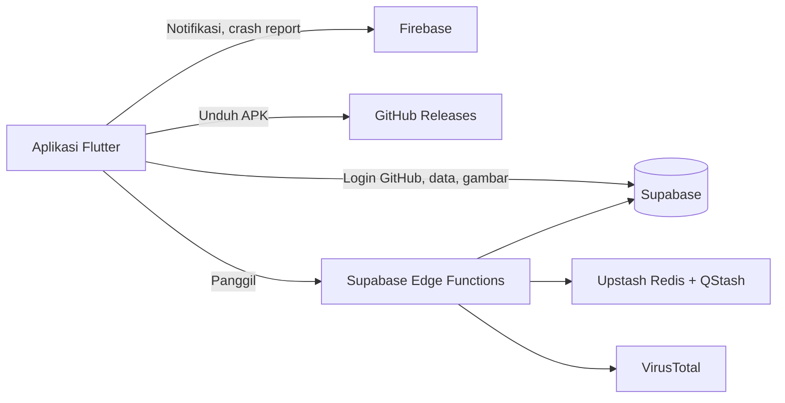

# ZamPlay

Toko aplikasi Android ala Play Store. Developer mengunggah aplikasi (utama **APK**, dengan arsitektur yang siap untuk tipe file lain), dan pengguna menelusuri, mengunduh, lalu memasangnya langsung dari aplikasi.

> Status: tahap awal (kerangka aplikasi, login GitHub, dan pipeline build APK).

## Fitur

**Pengguna**
- Beranda (populer, terbaru, kategori), pencarian, dan filter
- Detail aplikasi: ikon, screenshot, deskripsi, versi, ukuran, rating, ulasan, changelog
- Unduh dengan progress, lalu pasang APK dari dalam aplikasi
- Rating, ulasan, dan laporan aplikasi

**Developer**
- Unggah aplikasi lewat GitHub Releases miliknya sendiri
- Metadata APK dibaca otomatis (nama paket, versionCode, tanda tangan)
- Dashboard versi dan status moderasi

**Admin**
- Antrean moderasi (setujui atau tolak), kelola laporan, blokir developer atau aplikasi
- Hasil pemindaian malware (VirusTotal)

**Tipe file**

| Tipe | Perlakuan |
|---|---|
| APK | Unduh dan pasang |
| XAPK / APKS | Ekstrak, lalu pasang |
| AAB | Hanya informasi (tidak bisa dipasang langsung) |
| ZIP / EXE / AppImage | Hanya unduh |
| Web app | Tautan dan WebView |

## Arsitektur



| Layanan | Peran |
|---|---|
| **Supabase** | Auth (khusus GitHub OAuth), Postgres + RLS, Storage ikon dan screenshot |
| **GitHub Releases** | Penyimpanan file APK (di repo milik developer) |
| **Firebase** | Firestore (status realtime), FCM (notifikasi), Crashlytics |
| **Upstash** | Redis (cache, rate limit, penghitung unduhan) dan QStash (antrean tugas) |
| **VirusTotal** | Pemindaian malware, dipanggil lewat Edge Function |
| **GitHub Actions** | Build APK otomatis |

Prinsip keamanan: aplikasi hanya memegang kunci **publik** (Supabase anon key dan konfigurasi Firebase). Semua kunci sensitif hanya ada di Edge Functions atau GitHub Secrets.

## Teknologi

Flutter (stable), Dart, Material 3, Riverpod, go_router, supabase_flutter, Firebase (core, firestore, messaging, crashlytics), dio, flutter_secure_storage.

## Struktur repo

```
.
├── lib/                      # Kode aplikasi (clean architecture per fitur)
├── firebase/
│   └── google-services.json  # Konfigurasi Firebase Android (disalin otomatis ke android/app/)
├── supabase/
│   └── zamplay_schema.sql    # Skema database, RLS, trigger, storage
├── tools/
│   └── patch_android.py      # Skrip patch konfigurasi Android (idempotent)
├── .github/workflows/
│   ├── bootstrap.yml         # Membuat folder android/ lalu menerapkan patch
│   └── build-apk.yml         # Build APK dan unggah sebagai artifact
└── README.md
```

## Konfigurasi

| Item | Nilai |
|---|---|
| applicationId | `io.zamplay.app` |
| Deep link login | `io.zamplay.app://login-callback/` |
| minSdk | 24 |
| Supabase URL | `https://<PROJECT_REF>.supabase.co` |

### GitHub Secrets (build APK)

Repo > **Settings > Secrets and variables > Actions**:

| Name | Isi |
|---|---|
| `SUPABASE_URL` | URL project Supabase |
| `SUPABASE_ANON_KEY` | Kunci anon / publishable Supabase |

Nilai ini diteruskan ke aplikasi lewat `--dart-define` saat build. Jangan menulis key asli di kode atau README.

### Supabase Edge Functions > Secrets (kunci server)

`UPSTASH_REDIS_REST_URL`, `UPSTASH_REDIS_REST_TOKEN`, `QSTASH_TOKEN`, `QSTASH_CURRENT_SIGNING_KEY`, `QSTASH_NEXT_SIGNING_KEY`, `VIRUSTOTAL_API_KEY`.

## Setup dari nol

1. **Supabase**
   - Buat project, lalu jalankan `supabase/zamplay_schema.sql` sekali di **SQL Editor**.
   - **Authentication > Providers > GitHub**: aktifkan, isi Client ID dan Secret dari GitHub OAuth App (callback: `https://<PROJECT_REF>.supabase.co/auth/v1/callback`).
   - **Authentication > URL Configuration**: tambahkan redirect `io.zamplay.app://login-callback/`.
2. **Firebase**
   - Buat project, aktifkan Firestore, Cloud Messaging, dan Crashlytics (jangan aktifkan Storage).
   - Daftarkan aplikasi Android `io.zamplay.app`, unduh `google-services.json`, dan simpan di `firebase/`.
3. **Upstash dan VirusTotal**
   - Buat database Redis dan aktifkan QStash; buat API key VirusTotal.
   - Simpan semua nilainya di Supabase **Edge Functions > Secrets**.
4. **GitHub**
   - Tambahkan secrets `SUPABASE_URL` dan `SUPABASE_ANON_KEY`.

## Build APK (tanpa komputer)

1. Buka tab **Actions > Bootstrap > Run workflow**. Langkah ini membuat folder `android/` dan menerapkan patch (Firebase, izin, deep link, FileProvider). Cukup sekali.
2. Buka **Actions > Build APK > Run workflow** (juga berjalan otomatis di setiap push ke `main`).
3. Buka hasil run, unduh artifact **zamplay-debug**, ekstrak, lalu pasang APK di HP.

Android akan meminta izin **Install unknown apps** saat pemasangan pertama.

## Menjadikan akun sebagai admin

Status admin disimpan di `profiles.role` dan hanya bisa diubah lewat SQL Editor:

1. Login ke aplikasi dengan GitHub satu kali.
2. Jalankan di SQL Editor Supabase:

```sql
update public.profiles set role = 'admin' where github_username = 'USERNAME_GITHUB_KAMU';
```

## Keamanan dan kebijakan

- RLS aktif di semua tabel; status moderasi, role, rating, dan jumlah unduhan tidak bisa diubah dari aplikasi.
- Versi baru ditolak jika `versionCode` tidak naik atau tanda tangan APK berbeda dari versi sebelumnya.
- Hash SHA-256 diverifikasi setelah unduh; unggahan dibatasi ukuran dan frekuensinya.
- Dilarang mengunggah aplikasi bajakan, berbahaya, atau melanggar hukum. Setiap aplikasi dimoderasi sebelum tampil.
- Jangan pernah memasukkan Service Role key, token Upstash, atau key VirusTotal ke aplikasi atau repo.

## Peta jalan

- [x] Supabase: skema, RLS, GitHub OAuth, storage
- [x] Firebase: Firestore, Crashlytics, `google-services.json`
- [ ] (a) Kerangka aplikasi, login GitHub, pipeline build APK
- [ ] (b) Beranda dan detail aplikasi
- [ ] (c) Unduh dan pasang APK
- [ ] (d) Unggah developer lewat GitHub Releases
- [ ] (e) Panel admin dan Edge Functions (rate limit, hitung unduhan, pemindaian malware)
- [ ] Build rilis bertanda tangan (keystore di GitHub Secrets)

## Lisensi

Belum ditentukan.
